

**AUDIO SOFTWARE · ELECTRONIC INSTRUMENTS · MIDI · SOUND DESIGN**

# PROJECTS / AUDIO DEVELOPMENT

**ANKS Labs** développe principalement des outils pour créer de la musique : synthétiseurs, boîtes à rythmes, séquenceurs, effets, générateurs MIDI et applications souvent pensées pour **Ableton Live**, ainsi que quelques utilitaires. **Tous les projets sont en évolution**, à des stades très différents. Avant de télécharger, consultez chaque dépôt pour connaître **l'état du développement, les compatibilités et les licences**.

---

**ANKS Labs** mainly builds tools for making music — synthesizers, drum machines, sequencers, effects, MIDI generators and applications often designed around **Ableton Live**, alongside a few utility projects. **Everything is a work in progress**, and some projects are much further along than others. Check each repository for its **development status, compatibility and licence** before downloading.

[**SYNTHS, DRUMS & SEQUENCERS**](#synthesizers-drum-machines--sequencers) · [**MIDI / AUTOMATION**](#midi-generation--automation) · [**EFFECTS**](#audio-effects--processors) · [**APPLICATIONS**](#standalone-applications)

Le bouton rouge **TÉLÉCHARGER** de chaque projet affiche toujours le numéro de la **dernière version** et mène directement à son téléchargement, sans passer par le code. / The red **DOWNLOAD** button always shows the **latest version** number and takes you straight to it.

---

## SYNTHESIZERS, DRUM MACHINES & SEQUENCERS

<a href="https://github.com/olivershadd-star/Berhinger-Kick">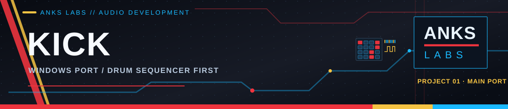</a>

**KICK** — Portage Windows indépendant de la **boîte à rythmes KICK** de Music Tribe / Behringer. Le travail reste centré sur l'original : adapter et fiabiliser le moteur, puis **reconstruire et améliorer le séquenceur** avant de faire évoluer progressivement la machine vers une véritable groovebox. Contrôle souris/clavier et recherches MIDI avec Maschine+ et LPD8.

*An independent Windows port of the original KICK drum machine. Sequencer first, expanded groovebox later.*

**Preview · version de test** · [Dépôt](https://github.com/olivershadd-star/Berhinger-Kick) · [Toutes les versions](https://github.com/olivershadd-star/Berhinger-Kick/releases)

---

<a href="https://github.com/olivershadd-star/KINETAKT">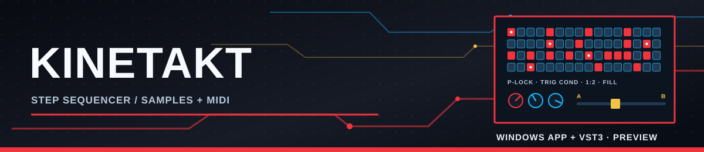</a>

**KINETAKT** *(anciennement ELEKTAKT)* — **Séquenceur pas à pas** pour Windows, en **application autonome et en VST3 pour Ableton Live** (Live Lite compris). Inspiré de la façon de travailler des machines Elektron : **parameter locks** par pas, **trig conditions**, probabilités, micro-timing, retrigs, **longueur et vitesse par piste**, scènes avec crossfader, LFO, générateur de motifs. Chaque piste joue un **sample** ou envoie des **notes MIDI**. Rééchantillonnage, découpage, réverbe et delay partagés, 8 sorties séparées dans Live. Construit sur le moteur audio de **KICK**.

*A free step sequencer for Windows, as a standalone app and a VST3 for Ableton Live: per-step parameter locks, trig conditions, per-track length and speed, scenes, sample and MIDI tracks. Inspired by the Elektron workflow; an independent project.*

**Preview · application Windows + VST3** · [Dépôt & mode d'emploi](https://github.com/olivershadd-star/KINETAKT) · [Toutes les versions](https://github.com/olivershadd-star/KINETAKT/releases)

---

<a href="https://github.com/olivershadd-star/MS1">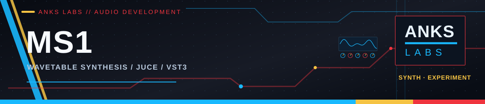</a>

**MS1** — **Synthétiseur wavetable** C++ / JUCE pour VST3 et Windows autonome : deux oscillateurs, modulation, filtres, séquenceur, resampling, rack de quatre slots FX, **213 presets** annoncés dans le dépôt. Un instrument déjà riche, mais encore en évolution et à tester en conditions musicales réelles.

*A wavetable synthesizer with modulation, effects, presets and sequencing — actively developed, not yet a polished final release.*

**Version de test · développement actif** · [Dépôt](https://github.com/olivershadd-star/MS1) · [Toutes les versions](https://github.com/olivershadd-star/MS1/releases)

---

<a href="https://github.com/olivershadd-star/MODULAR">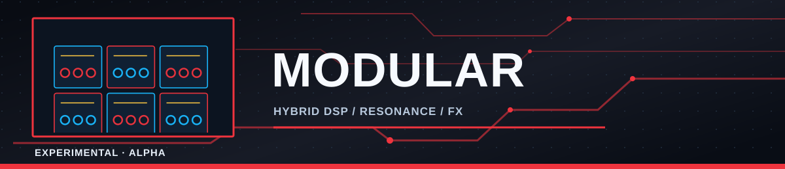</a>

**MODULAR** — **Synthétiseur hybride / laboratoire DSP** : excitations WAV, corps résonants, FM, séquenceur et chaîne de **six emplacements** avec **treize traitements** (granulaire, filtres, saturation, effets spectraux, phaser, delay…). Modulaire par ses chaînes d'effets et son approche expérimentale du son.

*Hybrid synthesis and sound-design laboratory with six effect slots and thirteen DSP treatments.*

**Version 1.4 alpha 3 · expérimental** · [Dépôt & documentation](https://github.com/olivershadd-star/MODULAR) · [Builds & tests](https://github.com/olivershadd-star/MODULAR/actions)

---

<a href="https://github.com/olivershadd-star/MOOGER">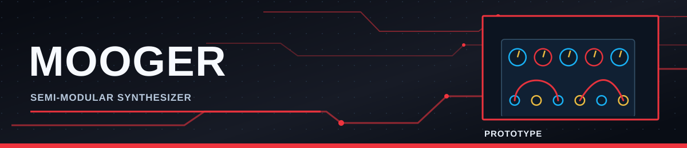</a>

**MOOGER** — **Synthétiseur semi-modulaire original**, avec deux oscillateurs, patching virtuel, filtre, VCA, modulation CV, séquenceur huit pas et voix de percussion indépendante. L'idée est d'explorer les interactions entre modules, pas de prétendre reproduire les circuits d'un instrument de marque.

*Original semi-modular synth with virtual patch cables, CV modulation, sequencer and a separate percussion voice.*

**Prototype v0.5 · tests Windows documentés** · [Dépôt](https://github.com/olivershadd-star/MOOGER) · [Builds de test](https://github.com/olivershadd-star/MOOGER/actions)

---

<a href="https://github.com/olivershadd-star/SWARM">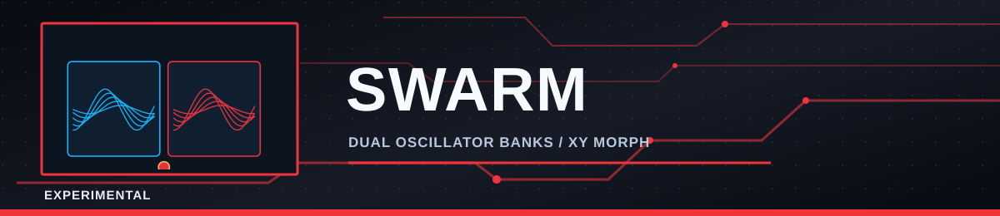</a>

**SWARM** — Synthé expérimental à **deux essaims de sept oscillateurs**, detune, largeur stéréo, filtre et **morphing XY** entre scènes. Une recherche sur les textures larges et les mouvements de timbre.

*Dual oscillator-swarm synthesis with four-scene XY morphing and expressive timbral motion.*

**Prototype · validation complète Windows/VST3 à poursuivre** · [Dépôt & architecture](https://github.com/olivershadd-star/SWARM)

---

## MIDI GENERATION & AUTOMATION

<a href="https://github.com/olivershadd-star/MLG-Alpha">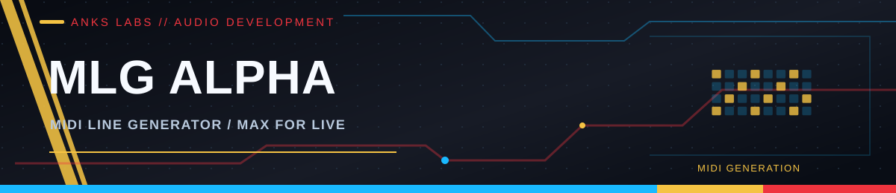</a>

**MLG ALPHA** — **Générateur de lignes MIDI pour Max for Live** : rythmes, basses, arpèges, mélodies et nappes. Génération guidée par gamme, probabilités, instructions textuelles, seeds et variations ; le README annonce une bibliothèque de **32 888 lignes**. Le résultat peut être écrit dans les clips d'Ableton.

*A Max for Live MIDI idea generator: rhythmic and melodic lines, guided variation and Ableton clip writing.*

**Alpha · vérifier compatibilité Max for Live et consignes d'installation** · [Dépôt & appareil](https://github.com/olivershadd-star/MLG-Alpha)

---

<a href="https://github.com/olivershadd-star/CURVE-EDITOR-M4L">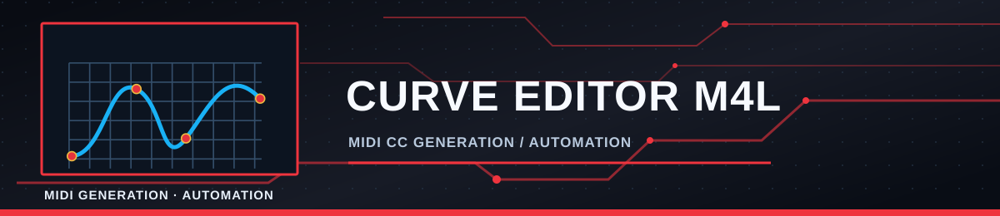</a>

**CURVE EDITOR M4L** — **Éditeur d'automation MIDI CC pour Ableton / Max for Live**, issu des recherches Curve Mini. **Huit lignes de courbes** indépendantes, canal et CC réglables, fenêtre graphique, pages Destination et Décrire/Code, import/export de sessions et courbes MIDI. Il génère des mouvements de paramètres, pas des sons.

*Draw up to eight MIDI CC automation curves in a dedicated Max for Live editor, with export and editable destinations.*

**Module en développement · consulter les tests Live du dépôt** · [Dépôt, installation & tests](https://github.com/olivershadd-star/CURVE-EDITOR-M4L)

---

## AUDIO EFFECTS & PROCESSORS

<a href="https://github.com/olivershadd-star/ANKS-FX-SUITE">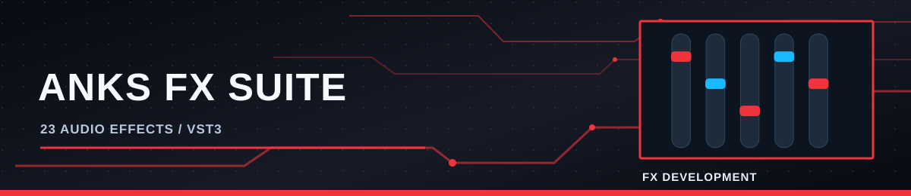</a>

**ANKS FX SUITE** — Point de regroupement des effets ANKS Labs : une **suite de 23 effets en chantier**, intégrant notamment les travaux sur **Triple Drive** (trois étages de distorsion) et d'autres modules de traitement. L'objectif est de centraliser le développement plutôt que créer un dépôt par effet.

*A unified home for twenty-three effects under development, including the Triple Drive distortion engine.*

**Chantier de suite FX · dépôt public, pas de pack complet confirmé** · [Dépôt de la suite](https://github.com/olivershadd-star/ANKS-FX-SUITE)

---

<a href="https://github.com/olivershadd-star/BEAT-JUGGLING">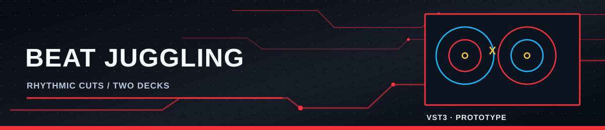</a>

**BEAT JUGGLING** — **Module VST3 de passe-passe rythmé** pour Ableton : deux platines virtuelles, chargement de sons, quatre patterns, blocs de lecture, scratch, backspin, roll et inversion. Le logiciel organise les allers-retours entre deux sources sur une grille synchronisée au tempo.

*Sequenced two-deck beat juggling, with timed cuts, scratch-like movements and four editable patterns.*

**Prototype VST3 · builds documentés dans Actions** · [Dépôt & fonctionnement](https://github.com/olivershadd-star/BEAT-JUGGLING)

---

<a href="https://github.com/olivershadd-star/FRAGMENT-ENGINE">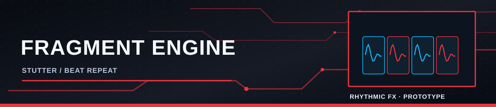</a>

**FRAGMENT ENGINE** — **Effet stutter / beat repeat** qui capture des fragments et les répète au rythme du morceau, avec modes Pattern et Step pour varier la hauteur. Moteur C++20 et intégration VST3 en développement.

*A rhythmic fragment-capture and repeat processor, including pitch-step patterns.*

**Prototype 0.3.0 · validation Windows/Ableton à poursuivre** · [Dépôt & documentation](https://github.com/olivershadd-star/FRAGMENT-ENGINE)

---

## STANDALONE APPLICATIONS

<a href="https://github.com/olivershadd-star/STAKER">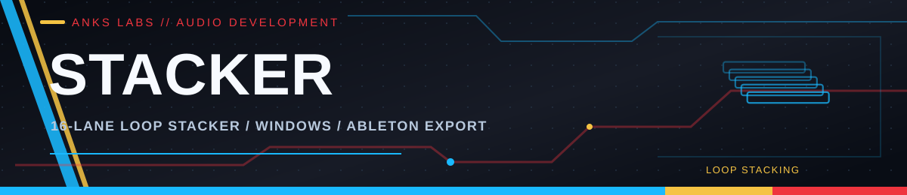</a>

**STACKER** — **Empileur autonome de loops**, ni synthé ni DAW complet. Seize lignes avec volumes, effets et mise au tempo, séquenceur de relances, blocs A–H, composition par empilement et export **WAV ou projet Ableton**. Le dépôt s'appelle encore `STAKER`, tandis que le projet est présenté ici sous le nom **Stacker**. Une déclinaison mobile est envisagée.

*A standalone loop-stacking workspace with sixteen lanes, pattern blocks and Ableton project export. A mobile adaptation is planned, not released.*

**Application Windows en développement** · [Dépôt & compilation](https://github.com/olivershadd-star/STAKER)

---

<a href="https://github.com/odoare/Mango">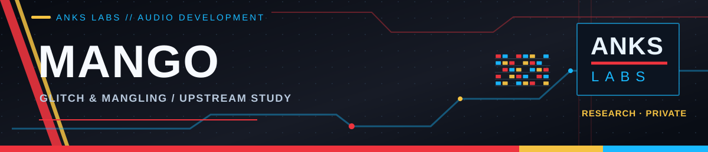</a>

**MANGO / FX-MECHANICS** — Projet open source original d'**Olivier Doaré**, étudié au laboratoire : **séquenceur de blocs d'effets** avec plusieurs pistes, glitch, stutter, mangling et empilement de traitements suivant la grille rythmique. C'est davantage un outil de manipulation audio par blocs qu'un synthétiseur. Le fork ANKS Labs reste **privé** ; aucune adaptation ANKS téléchargeable n'est annoncée.

*An open-source effect-block sequencer under private ANKS Labs study. Original project by Olivier Doaré; no public ANKS build.*

**Étude / adaptation privée · crédits et licence de l'auteur d'origine** · [Projet original & documentation](https://github.com/odoare/Mango)

**Autres expérimentations / Other experiments :** [Curve Pilot — hébergement VST3 & courbes](https://github.com/olivershadd-star/CURVE-PILOT) · [Curve Mini — recherche archivée](https://github.com/olivershadd-star/Curve-Mini) · [Surge XT — source ouverte étudiée](https://github.com/surge-synthesizer/surge). Ces pistes ne sont pas annoncées comme des releases stables.

---

# ABOUT ANKS LABS / QUI SOMMES-NOUS ?

## ANKS LABS — PRÉSENTATION

**ANKS Labs** est un laboratoire indépendant de création et d'expérimentation consacré à la production musicale électronique. Il explore les **instruments virtuels, les moteurs audio, les effets VST3, les applications Windows, les séquenceurs, le contrôle MIDI** et, ponctuellement, de petits outils utilitaires.

Le laboratoire développe ses propres idées, mais étudie aussi des **projets open source** pour comprendre leur architecture, les adapter à d'autres machines ou méthodes de travail et expérimenter de nouvelles possibilités. Les sources ouvertes de [Music Tribe / Behringer](https://github.com/MusicTribeOpenSource), les architectures de [Surge XT](https://github.com/surge-synthesizer/surge) ou le travail d'[Olivier Doaré sur Mango](https://github.com/odoare/Mango) constituent des exemples de cette curiosité technique. Les marques et licences restent celles de leurs auteurs.

### ANKS / ANIKI SHAD

**ANKS**, porté par **Aniki Shad**, fait le lien entre la passion pour la musique et l'expérimentation technique. Après **plus de trente ans de passion musicale**, mais sans formation classique en programmation, l'arrivée des outils d'intelligence artificielle a ouvert une possibilité nouvelle : **fabriquer et adapter lui-même les instruments et logiciels qu'il voulait utiliser**.

Le *vibe coding* ne sert pas ici uniquement à produire rapidement des logiciels destinés à la vente. C'est avant tout une façon **d'apprendre en construisant, d'essayer, de se tromper, de corriger et de partager**. La musique reste le point de départ ; le code, les machines et l'IA sont des moyens.

ANKS Labs travaille et échange avec des **musiciens, des passionnés et de petits producteurs indépendants**, dont les projets donnent un terrain concret à ces expérimentations. La démarche n'est **pas systématiquement commerciale** : elle privilégie la curiosité, l'autonomie et la circulation des idées.

### NOTRE PHILOSOPHIE

**Tester, comprendre, transformer et partager.** Si un outil fonctionne, autant l'utiliser pour faire de la musique. S'il peut être amélioré, autant essayer. Et si un autre développeur propose une bonne idée, autant dialoguer, apprendre et améliorer encore — dans le respect des licences.

**Vous ne savez pas coder ?** Testez les versions disponibles, faites du son et partagez vos retours. **Vous codez aussi ?** Forkez les projets lorsque leurs licences le permettent, apportez vos modifications et montrez ce que vous avez construit. L'échange fonctionne dans les deux sens.

> **Nous n'avons pas tous appris à programmer. Mais nous pouvons apprendre à construire.**
>
> **BUILD. BREAK. REWIRE. LISTEN. SHARE.**

---

## ANKS LABS — PRESENTATION

**ANKS Labs** is an independent laboratory dedicated to experimental tools for electronic music production: **virtual instruments, audio engines, VST3 effects, Windows applications, sequencers, MIDI control systems** and occasional utility software.

The lab develops original ideas while studying **open-source projects** to understand how they work, adapt them to different workflows and explore new possibilities. Sources from [Music Tribe / Behringer](https://github.com/MusicTribeOpenSource), [Surge XT](https://github.com/surge-synthesizer/surge) and [Mango by Olivier Doaré](https://github.com/odoare/Mango) are examples of the technical landscape we explore. Original authors, trademarks and licences remain fully acknowledged.

### ANKS / ANIKI SHAD

**ANKS**, represented by **Aniki Shad**, connects a long-standing passion for music with technical experimentation. After **more than thirty years of making and exploring music**, but without a traditional programming background, AI-assisted development opened a new door: **building and adapting the software instruments and tools he actually wanted to use**.

Here, *vibe coding* is not merely a shortcut to mass-produce software for sale. It is a way **to learn by building, experiment, make mistakes, fix things and share discoveries**. Music comes first; code and AI are tools for getting there.

ANKS Labs exchanges ideas with **musicians, enthusiasts and small independent producers** whose music provides a real-world testing ground. There is **no systematic commercial agenda**: curiosity, independence and knowledge-sharing come first.

### OUR PHILOSOPHY

**Test, understand, transform and share.** If a tool works, make music with it. If it can be improved, experiment. If another developer has a better idea, learn from it and keep building — while respecting applicable licences.

**Not a developer?** Try available builds, create music and share your feedback. **Writing code yourself?** Fork projects where the licence permits it, show your modifications and exchange ideas with us. Collaboration should go both ways.

> **We may not all have learned to code. But we can learn to build.**
>
> **BUILD. BREAK. REWIRE. LISTEN. SHARE.**

### AU-DELÀ DES MACHINES — AI, PROMPTS & METHODS

Au-delà des VST et des machines, **ANKS Labs développe aussi des méthodes** : générateurs de prompts pour l'IA musicale (dont l'approche **ANKS Sound Editor**), conception de rythmes et de textures, *vibe coding* appliqué à l'audio, documentation de passation, tests reproductibles et méthodes de collaboration avec les IA. Le but est de rendre ces pratiques compréhensibles et utiles, même sans formation de développeur.

Beyond VSTs and hardware, **ANKS Labs also develops methods**: musical-AI prompt generators (including **ANKS Sound Editor**), rhythm and sound-design workflows, AI-assisted coding, handover documentation, repeatable testing and ways to collaborate with AI systems. The aim is to make these tools genuinely useful to music makers, including those without a programming background.

**Un programme qui compile n'est pas forcément un programme qui sonne bien. / A successful build does not replace listening and real musical testing.**

---

## MUSIC CONNECTION — HURk

**Vous voulez savoir ce que ces expérimentations donnent musicalement ?** Écoutez **HURk**, projet de musique électronique industrielle, où se rencontrent créations assistées par IA musicale, travail sonore et outils conçus ou expérimentés au sein d'ANKS Labs.

**Curious about the music behind these experiments?** Discover **HURk**, an industrial electronic music project combining AI-assisted music creation, sound design and software developed or tested within ANKS Labs.

---

## SHARING, LICENCES & CONTRIBUTIONS / PARTAGE ET CONTRIBUTIONS

**ANKS Labs** encourage les tests, les retours, les forks et le partage des améliorations. Mais **un dépôt public n'est pas automatiquement un logiciel libre** : vérifiez la licence propre à chaque projet avant de copier, modifier ou redistribuer son code. Les portages de Music Tribe et l'étude de Mango restent soumis aux licences de leurs auteurs et composants respectifs. Les noms de marques appartiennent à leurs titulaires ; ces expérimentations sont indépendantes.

**ANKS Labs** welcomes testing, feedback, forks and shared improvements. However, **a public repository is not automatically open-source software**: check its actual licence before copying, modifying or redistributing code. Music Tribe adaptations and Mango research remain subject to their authors' and dependencies' licences. Trademarks belong to their owners; these projects are independent.

---

## CONTACT, FEEDBACK & COLLABORATION

Un bug, une meilleure idée, un fork, une remarque sur le son ou une proposition de collaboration ? Utilisez les **Issues**, **Pull Requests** ou **Discussions** des dépôts publics lorsqu'elles sont activées.

Found a bug, made an improvement or built an alternative version? Use the public repositories' **Issues**, **Pull Requests** or **Discussions**, where available.

**ANKS LABS — BUILD. BREAK. REWIRE. LISTEN. SHARE.**

[**ALL PUBLIC REPOSITORIES / TOUS LES PROJETS PUBLICS**](https://github.com/olivershadd-star?tab=repositories)

Independent audio development · Electronic instruments · AI-assisted creative workflows

