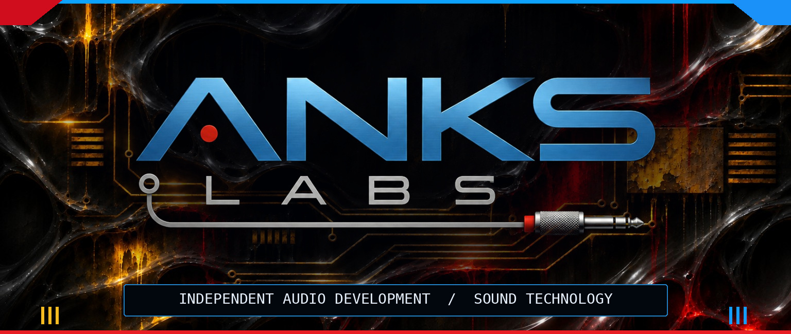
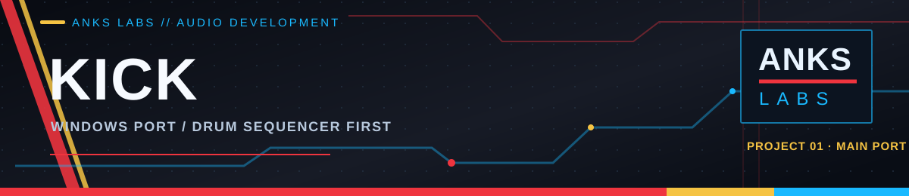
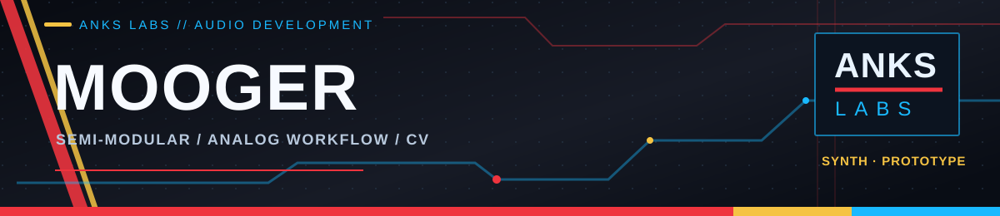
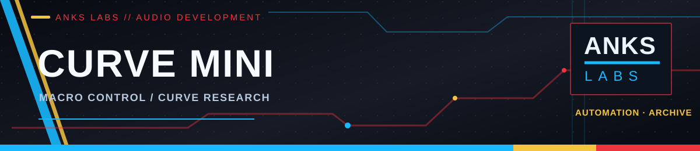
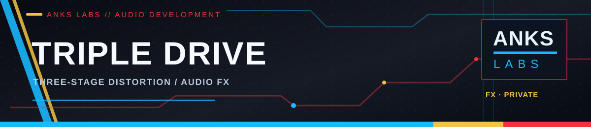

 

**AUDIO SOFTWARE · ELECTRONIC INSTRUMENTS · MIDI SYSTEMS · AI WORKFLOWS**

**BUILD. BREAK. REWIRE. LISTEN.**

---

## 00 // ANKS LABS — PRÉSENTATION

**ANKS Labs** est un laboratoire indépendant consacré à la conception et à l'expérimentation d'outils pour la production musicale électronique : **instruments virtuels, synthétiseurs, moteurs audio, effets VST3, applications Windows, séquenceurs, systèmes de contrôle MIDI et générateurs de prompts pour l'IA musicale**.

Le laboratoire ne développe pas seulement des logiciels. Il expérimente aussi **de nouvelles méthodes de travail avec les intelligences artificielles** : conception assistée, *vibe coding*, organisation de projets, analyses de code, itérations, tests, documentation et méthodes de création sonore. L'IA est ici un outil à comprendre, à questionner et à apprendre à utiliser, pas une baguette magique dispensant de vérifier ce que l'on fabrique.

ANKS Labs explore autant la **création d'instruments originaux** que l'**étude et l'adaptation de projets open source existants**. Parmi les univers et communautés qui nourrissent ces recherches figurent [Behringer / Music Tribe](https://github.com/MusicTribeOpenSource), [Surge XT](https://github.com/surge-synthesizer/surge), [Mango / Olivier Doaré](https://github.com/odoare/Mango) et les outils de production associés aux contrôleurs **Akai** ou **Native Instruments**. Il s'agit de sources d'étude, d'inspirations ou d'intégrations MIDI selon les cas, et non d'affirmer que tous ces fabricants publient les mêmes éléments sous licence libre.

### ANKS / ANIKI SHAD

**ANKS**, porté par **Aniki Shad**, fait le lien entre **création musicale** et **expérimentation technique**.

Passionné de musique depuis **plus de trente ans**, mais sans formation ni connaissance préalable en développement logiciel, Aniki Shad a découvert avec les outils d'IA une possibilité qui lui était auparavant inaccessible : **concevoir lui-même les instruments et applications qu'il rêvait d'utiliser**. Le développement devient alors une extension de la passion pour la musique, le son, les machines et la recherche.

Cette démarche est aussi une réaction à l'essor d'un modèle où le *vibe coding* sert parfois à fabriquer rapidement une multitude d'outils pour les commercialiser. **ANKS Labs défend une autre vision : l'IA ouvre enfin le développement à des passionnés qui n'en avaient pas les moyens techniques.** Pour ce laboratoire, cette ouverture doit d'abord favoriser la création, l'autonomie, la curiosité et l'échange, plutôt que transformer chaque expérimentation en produit à vendre.

### NOTRE PHILOSOPHIE : FAIRE, PARTAGER, REPRENDRE, AMÉLIORER

L'objectif est de **tester, comprendre, transformer, adapter à ses besoins et partager** des outils utiles à la création sonore, **sans démarche commerciale systématique**.

**Vous ne codez pas ?** Si une version téléchargeable vous intéresse, utilisez-la, testez-la, faites de la musique avec elle. Ces projets sont aussi là pour ça.

**Vous développez aussi ?** Récupérez les idées et les projets dans les limites de leurs licences, créez vos propres versions, modifiez-les, poussez-les ailleurs. Et surtout, **montrez ce que vous en avez fait !** ANKS Labs aimerait découvrir vos forks, tester vos améliorations, échanger des méthodes et, lorsque les droits le permettent, **réutiliser à son tour vos bonnes idées**. C'est une circulation dans les deux sens : personne ne détient le monopole de la bonne solution.

L'esprit recherché est celui d'un **atelier collectif de passionnés**, où chaque variante peut devenir le point de départ d'une autre. Cette envie de réciprocité est une **philosophie de collaboration** ; les obligations juridiques de redistribution restent celles des licences de chaque dépôt.

> **Nous n'avons pas tous appris à programmer. Mais nous pouvons apprendre à construire.**
>
> **BUILD. BREAK. REWIRE. LISTEN. SHARE.**

ANKS Labs travaille et échange avec des musiciens et de **petits producteurs indépendants**, notamment autour de la musique électronique et industrielle. **HURk** est l'un de ces projets : un univers où les textures, les rythmiques mécaniques et les expérimentations sonores donnent un contexte concret aux outils développés.

---

## 01 // MUSIC CONNECTION — HURk

**L'idée est de construire des outils pour faire de la musique, pas seulement pour produire du code.** Pour découvrir l'univers sonore de **HURk**, projet de musique électronique industrielle :

---

# PROJECTS // AUDIO DEVELOPMENT

**Attention :** la présence d'un projet sur GitHub ne signifie ni qu'il est stable, ni que son code est automatiquement réutilisable sans condition. Les statuts de test et les licences sont indiqués par projet.

## 02 // OPEN-SOURCE ADAPTATIONS — PROJET PRINCIPAL

  

### KICK LAB — LA MACHINE QUI A TOUT DÉCLENCHÉ

**KICK Lab est aujourd'hui le projet central d'ANKS Labs**, et surtout **celui qui a véritablement lancé l'aventure du vibe coding**.

En octobre 2026, **Music Tribe / Behringer** a publié le code source de sa future groovebox **KICK** ([projet officiel BE 0700-AAM](https://github.com/MusicTribeOpenSource/0700-AAM)) **alors que la machine matérielle n'était pas encore commercialisée**. Pour un passionné de cette marque et de ce type de machines, c'était une occasion rare : accéder à l'architecture d'un instrument à venir, explorer son code et essayer d'en tirer un outil concret, avec l'aide de l'IA, sans être développeur de métier.

**L'idée n'est pas de reproduire ni de vendre une KICK officielle.** ANKS Labs travaille sur un **portage autonome Windows**, indépendant du constructeur, à partir des sources ouvertes, pour utiliser cette logique de groovebox sans dépendre de la surface matérielle originale.

Le travail porte à la fois sur le moteur audio, les fonctions musicales, l'interface Windows, les tests et le **contrôle MIDI par des surfaces déjà présentes dans un home studio**. Une grande partie de l'intérêt vient de la possibilité de détourner et personnaliser le flux de travail : apprendre comment la machine fonctionne, puis **adapter son comportement à ses propres besoins**.

**Fonctions documentées dans la version 0.24.0 preview :**
- **16 pads** et kits sauvegardables ; **8 patterns A–H**, de 1 à 4 mesures ; séquenceur graphique et enregistrement quantifié.
- Jeu et édition en modes **Pad, Keyboard, Chords et Step**, avec édition des événements.
- **Mixage par pads et pistes**, mute/solo, quatre inserts par pad, effets et export **WAV stéréo**.
- Chargement de **samples personnels** via une bibliothèque externe.
- **Maschine+ en mode contrôleur** pour piloter pads, encodeurs et commandes ; **Akai LPD8** pour les patterns et macros ; **MPK Mini** pour le jeu mélodique.
- Les contrôleurs sont reliés au **PC et à ses entrées MIDI**. KICK Lab reste utilisable uniquement à la souris et au clavier.

**Statut : version publique de test, non stable.** Le portage, les performances, l'intégration MIDI et une éventuelle version VST3 restent des chantiers. Ce projet indépendant ne constitue **ni un firmware officiel Behringer, ni une annonce de disponibilité du matériel KICK**. Les marques et les sources originales restent créditées.

**[⬇ Télécharger KICK Lab 0.24.0 preview](https://github.com/olivershadd-star/Berhinger-Kick/releases/tag/v0.24.0-preview)** · **[Code & documentation](https://github.com/olivershadd-star/Berhinger-Kick)** · **[Sources originales Music Tribe](https://github.com/MusicTribeOpenSource/0700-AAM)**

---

## 03 // ORIGINAL ANKS LABS INSTRUMENTS

Cette famille rassemble les **instruments de génération et de transformation sonore** conçus au laboratoire : synthèse wavetable, semi-modulaire, résonance hybride, oscillateurs et morphing. Les prototypes ne doivent pas être confondus avec des versions commerciales finalisées.

 

**[MS1](https://github.com/olivershadd-star/MS1)** explore la **synthèse wavetable** et l'organisation d'un instrument compact : unison, filtre, enveloppe de modulation, LFO, séquenceur pas à pas et banque de presets. Son point de départ est une réflexion sur certaines **approches musicales** de Massive et Serum, sans reprise de leurs codes ou interfaces.

**Statut : prototype JUCE / VST3**, builds expérimentaux via GitHub Actions ; validation en situation réelle à poursuivre. **[Projet et builds de test](https://github.com/olivershadd-star/MS1/actions)**.

---

 

**[MOOGER](https://github.com/olivershadd-star/MOOGER)** est un synthétiseur **semi-modulaire original**, avec deux oscillateurs, filtre résonant, VCA, patching virtuel, séquenceur huit pas et une voix de percussion indépendante. Le laboratoire de modulation comprend LFO, bruit, sample & hold, atténuateurs, mixeur CV et lag.

Le but est de comprendre et d'explorer les interactions entre les blocs d'un synthétiseur, **pas de reproduire les circuits propriétaires d'une machine existante**. Compilation et tests automatisés Windows documentés ; **l'écoute et la validation dans Ableton restent à confirmer**. **[Sources et tests](https://github.com/olivershadd-star/MOOGER)**.

---

 

**[MODULAR / ANKS Resonant Lab](https://github.com/olivershadd-star/MODULAR)** est un laboratoire de **synthèse hybride VST3 et standalone Windows**. Il combine les **excitations WAV** et sources internes, un **double corps résonant**, une **FM à deux opérateurs** et des modules de traitement réordonnables.

Le moteur explore notamment les textures granulaires, la matière résonante, le **frequency shifting**, le **freeze spectral** et les interactions entre sources et traitements. Les performances et les limites du DSP font partie intégrante du travail. **Statut : alpha expérimentale, en développement**. **[Documentation et architecture](https://github.com/olivershadd-star/MODULAR)**.

---

 

**[SWARM / 01](https://github.com/olivershadd-star/SWARM)** développe un synthétiseur original à **deux bancs de sept oscillateurs PolyBLEP**, avec détune, stéréo, filtre résonant et **morphing XY entre quatre scènes**. Il sert à étudier les nappes larges, les mouvements de timbre et le contrôle expressif.

**Statut : moteur DSP testé hors JUCE ; VST3 et standalone Windows encore à valider sur la machine cible.** Ce n'est pas une version stable. **[Architecture et sources](https://github.com/olivershadd-star/SWARM)**.

---

## 04 // AUTOMATION · MIDI TOOLS · FX

Ici, on quitte les synthétiseurs pour se concentrer sur **ce qui contrôle, module, transforme ou détruit le son** : automation de paramètres, séquençage de courbes, routage MIDI et effets. Les expérimentations visent notamment **Ableton Live**, le **format VST3** et, lorsque c'est pertinent, **Max for Live**.

**[CURVE PILOT](https://github.com/olivershadd-star/CURVE-PILOT)** — outil de **dessin graphique de courbes** et de **pilotage de paramètres d'instruments hébergés**. Le projet explore plusieurs lignes d'automation, des formes complexes, les modifications sur une ou plusieurs mesures et la connexion à un instrument VST3 chargé.

**Statut : développement expérimental** ; les questions de charge CPU, de stabilité du host et de dialogue avec les plugins sont prioritaires. **[Voir le projet](https://github.com/olivershadd-star/CURVE-PILOT)**.

---

**[CURVE MINI](https://github.com/olivershadd-star/Curve-Mini)** — recherche autour d'un éditeur de courbes plus léger, et des limites du pilotage de macros externes par un simple VST3. Cette piste a permis de mieux cerner ce qui exige un hébergement ou une intégration au DAW.

**Statut : expérimentation archivée ; ne pas considérer comme plugin universel prêt à l'emploi.** **[Lire le retour d'expérience](https://github.com/olivershadd-star/Curve-Mini)**.

---

**[CURVE EDITOR M4L](https://github.com/olivershadd-star/CURVE-EDITOR-M4L)** — piste d'intégration **Max for Live / Ableton Live** pour dessiner des courbes et agir plus directement sur des paramètres ou des macros, à l'échelle d'une mesure comme d'une séquence.

**Statut : projet en préparation, aucun patch prêt à installer annoncé.** **[Consulter le dépôt](https://github.com/olivershadd-star/CURVE-EDITOR-M4L)**.

---

**[FRAGMENT ENGINE](https://github.com/olivershadd-star/FRAGMENT-ENGINE)** — effet **stutter / beat repeat** synchronisé au transport : capture de fragments courts, répétitions rythmiques, réglages Stutter / Refresh et transformations de hauteur en modes Pattern ou Step. Le DSP C++20 se développe indépendamment du SDK hôte.

**Statut : prototype VST3 ; tests du moteur et sous Linux documentés, validation Windows / Ableton à poursuivre.** **[Code et documentation](https://github.com/olivershadd-star/FRAGMENT-ENGINE)**.

---

**TRIPLE DRIVE** — expérimentation autour d'une **distorsion VST3 à trois étages**, chacun contrôlable ou désactivable indépendamment. L'objectif est d'obtenir un grain dense mais maîtrisé, avec une architecture exploitable sans empiler inutilement plusieurs plugins.

**Statut : projet privé, en évolution ; aucune version publique ni lien de téléchargement annoncé pour l'instant.**

---

## 05 // OPEN-SOURCE RESEARCH & ADAPTATIONS

**MANGO / FX-Mechanics** — étude et adaptation expérimentale du projet open source de **[Olivier Doaré](https://github.com/odoare/Mango)** : séquençage d'effets, glitch, mangling, traitement par blocs et variations reproductibles. **Le dépôt ANKS Labs est privé ; aucune version modifiée téléchargeable n'est annoncée.** Les crédits et conditions de licence de l'auteur original s'appliquent.

**[Surge XT](https://github.com/surge-synthesizer/surge)** est également une référence open source à **tester, étudier et comprendre** pour ses architectures de synthèse, de modulation et d'organisation du code. Cela ne signifie pas qu'un fork ANKS Labs a été publié.

L'intégration de **surfaces MIDI Akai, Maschine+ et d'autres contrôleurs** relève quant à elle de la recherche sur les interfaces et les usages matériels ; ce n'est pas une revendication de code open source provenant de ces marques.

## 06 // IA MUSICALE · PROMPTS · VIBE CODING

Au-delà des VST et des machines, ANKS Labs développe aussi **des méthodes** :

- **Générateurs de prompts et outils d'aide à l'IA musicale** — notamment la piste ANKS Sound Editor, avec paramètres de style, structures rythmiques, exclusions et contraintes de sound design.
- **Vibe coding appliqué à l'audio** — partir d'un besoin musical, décomposer l'idée en modules, faire produire et relire le code, compiler, tester l'audio réellement et itérer.
- **Méthodes de collaboration avec les IA** — documents de passation, cahiers de conception, tests reproductibles, comparaisons de versions et séparation entre ce qui fonctionne et ce qui reste à vérifier.
- **Transmission** — rendre ces méthodes compréhensibles pour des musiciens curieux qui n'ont pas commencé par une formation de développeur.

**L'outil IA ne remplace pas l'écoute ni les essais.** Une compilation réussie ne prouve pas qu'un synthétiseur sonne bien, qu'un VST est stable ou qu'un routage MIDI fonctionne dans une vraie session musicale. C'est aussi ce que les projets ANKS Labs cherchent à apprendre.

---

## 07 // PARTAGE, LICENCES & CONTRIBUTIONS

**Vous êtes libre d'écouter, de tester, de vous inspirer et, dans les conditions prévues par les licences, de modifier les projets.** Les retours, variantes et contributions sont particulièrement bienvenus.

**Le souhait d'ANKS Labs est la réciprocité** : si un projet vous donne des idées et que vous en faites une autre version, partager les modifications, les retours d'expérience ou le lien vers votre fork permet à tout le monde de progresser. Vous n'avez pas besoin d'être développeur pour profiter des versions publiées.

**Mais la philosophie de partage n'est pas une licence juridique.** Chaque dépôt indique les droits applicables :
- **KICK Lab** s'appuie sur le code Music Tribe sous **AGPL-3.0-or-later**, avec des dépendances relevant de leurs propres licences. En cas de redistribution de versions modifiées, les obligations légales correspondantes doivent être respectées.
- **Curve Mini** contient une licence MIT ; d'autres prototypes peuvent avoir des conditions différentes.
- **Un dépôt public n'est pas automatiquement open source** : sans licence accordant des droits, la visibilité du code ne vaut pas autorisation générale de le redistribuer ou d'en faire une œuvre dérivée.
- Pour les projets originaux futurs, le choix d'une licence favorisant réellement le partage des améliorations devra être **examiné séparément**, en tenant compte du code tiers et des dépendances.

Les marques **Behringer, Music Tribe, Akai, Native Instruments, Maschine, Massive, Serum** et les autres marques citées appartiennent à leurs propriétaires. Les adaptations et prototypes ANKS Labs sont **indépendants et non officiels**.

---

## 08 // CONTACT · ÉCHANGE · PARTICIPATION

Vous avez testé une version ? Vous avez développé une variante ? Un bug corrigé, une interface différente, un module amélioré, une idée de workflow ou simplement une remarque sur le son ?

**Parlons-en.** Les **Issues**, **Pull Requests** et **Discussions** des dépôts publics, lorsqu'elles sont ouvertes, sont les meilleurs endroits pour échanger et documenter les évolutions.

---

**ANKS LABS**

**BUILD. BREAK. REWIRE. LISTEN. SHARE.**

[**TOUS LES REPOSITORIES PUBLICS**](https://github.com/olivershadd-star?tab=repositories) · [**ÉCOUTER HURk**](https://soundcloud.com/hurk666)

Independent audio development · Experimental electronic instruments · AI-assisted workflows

