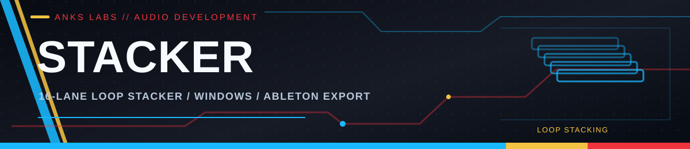
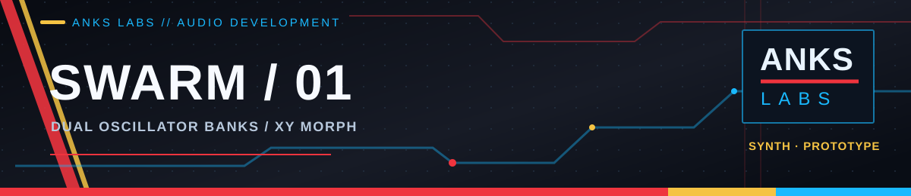
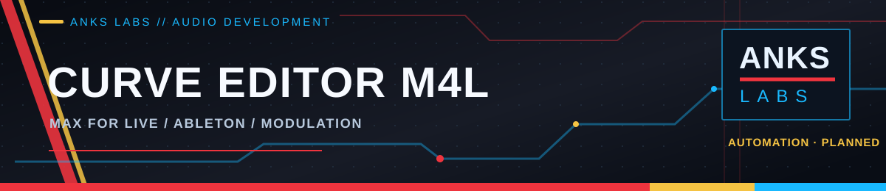
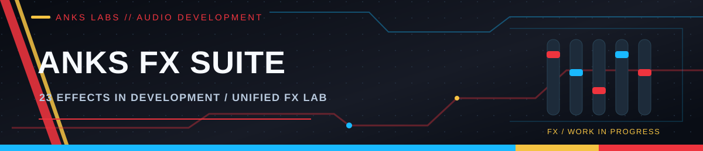
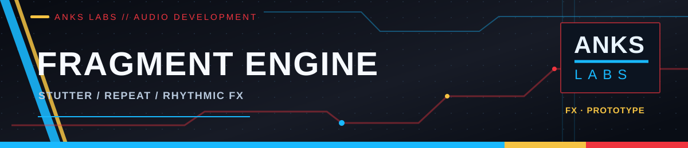
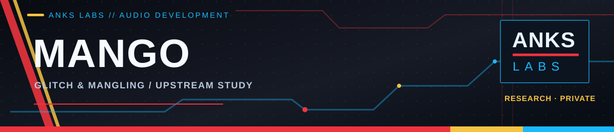

 

**AUDIO SOFTWARE · ELECTRONIC INSTRUMENTS · MIDI SYSTEMS · AI WORKFLOWS**

**BUILD. BREAK. REWIRE. LISTEN.**

---

## 00 // ANKS LABS — PRÉSENTATION

**ANKS Labs** est un laboratoire indépendant consacré à la conception et à l'expérimentation d'outils pour la production musicale électronique : **instruments virtuels, synthétiseurs, moteurs audio, effets VST3, applications Windows, séquenceurs, systèmes de contrôle MIDI et générateurs de prompts pour l'IA musicale**.

Le laboratoire ne développe pas seulement des logiciels. Il expérimente aussi **de nouvelles méthodes de travail avec les intelligences artificielles** : conception assistée, *vibe coding*, organisation de projets, analyses de code, itérations, tests, documentation et méthodes de création sonore. L'IA est ici un outil à comprendre, à questionner et à apprendre à utiliser, pas une baguette magique dispensant de vérifier ce que l'on fabrique.

ANKS Labs explore autant la **création d'instruments originaux** que l'**étude et l'adaptation de projets open source existants**. Parmi les univers et communautés qui nourrissent ces recherches figurent [Behringer / Music Tribe](https://github.com/MusicTribeOpenSource), [Surge XT](https://github.com/surge-synthesizer/surge), [Mango / Olivier Doaré](https://github.com/odoare/Mango) et les outils de production associés aux contrôleurs **Akai** ou **Native Instruments**. Il s'agit de sources d'étude, d'inspirations ou d'intégrations MIDI selon les cas, et non d'affirmer que tous ces fabricants publient les mêmes éléments sous licence libre.

### ANKS / ANIKI SHAD

**ANKS**, porté par **Aniki Shad**, fait le lien entre **création musicale** et **expérimentation technique**.

Passionné de musique depuis **plus de trente ans**, mais sans formation ni connaissance préalable en développement logiciel, Aniki Shad a découvert avec les outils d'IA une possibilité qui lui était auparavant inaccessible : **concevoir lui-même les instruments et applications qu'il rêvait d'utiliser**. Le développement devient alors une extension de la passion pour la musique, le son, les machines et la recherche.

Cette démarche est aussi une réaction à l'essor d'un modèle où le *vibe coding* sert parfois à fabriquer rapidement une multitude d'outils pour les commercialiser. **ANKS Labs défend une autre vision : l'IA ouvre enfin le développement à des passionnés qui n'en avaient pas les moyens techniques.** Pour ce laboratoire, cette ouverture doit d'abord favoriser la création, l'autonomie, la curiosité et l'échange, plutôt que transformer chaque expérimentation en produit à vendre.

### NOTRE PHILOSOPHIE : FAIRE, PARTAGER, REPRENDRE, AMÉLIORER

L'objectif est de **tester, comprendre, transformer, adapter à ses besoins et partager** des outils utiles à la création sonore, **sans démarche commerciale systématique**.

**Vous ne codez pas ?** Si une version téléchargeable vous intéresse, utilisez-la, testez-la, faites de la musique avec elle. Ces projets sont aussi là pour ça.

**Vous développez aussi ?** Récupérez les idées et les projets dans les limites de leurs licences, créez vos propres versions, modifiez-les, poussez-les ailleurs. Et surtout, **montrez ce que vous en avez fait !** ANKS Labs aimerait découvrir vos forks, tester vos améliorations, échanger des méthodes et, lorsque les droits le permettent, **réutiliser à son tour vos bonnes idées**. C'est une circulation dans les deux sens : personne ne détient le monopole de la bonne solution.

L'esprit recherché est celui d'un **atelier collectif de passionnés**, où chaque variante peut devenir le point de départ d'une autre. Cette envie de réciprocité est une **philosophie de collaboration** ; les obligations juridiques de redistribution restent celles des licences de chaque dépôt.

> **Nous n'avons pas tous appris à programmer. Mais nous pouvons apprendre à construire.**
>
> **BUILD. BREAK. REWIRE. LISTEN. SHARE.**

ANKS Labs travaille et échange avec des musiciens et de **petits producteurs indépendants**, notamment autour de la musique électronique et industrielle. **HURk** est l'un de ces projets : un univers où les textures, les rythmiques mécaniques et les expérimentations sonores donnent un contexte concret aux outils développés.

---

## 01 // MUSIC CONNECTION — HURk

**L'idée est de construire des outils pour faire de la musique, pas seulement pour produire du code.** Pour découvrir l'univers sonore de **HURk**, projet de musique électronique industrielle :

---

# PROJECTS // AUDIO DEVELOPMENT

**Le laboratoire ne se résume pas à une collection de synthétiseurs.** Les projets vont de la boîte à rythmes au séquenceur MIDI, du VST3 à Max for Live, de l'empileur de loops aux outils pour Ableton. Chaque famille répond à un besoin musical différent.

**Important :** les dépôts publics ne sont pas tous des releases stables ni automatiquement des logiciels open source réutilisables sans condition. Vérifiez les licences, les versions de test et les instructions propres à chaque dépôt.

## 02 // KICK — PORTAGE WINDOWS & SÉQUENCEUR

  

**[KICK](https://github.com/olivershadd-star/Berhinger-Kick)** est le portage Windows indépendant du code de la boîte à rythmes KICK publié par **Music Tribe / Behringer**. C'est le projet qui a lancé les premières expérimentations concrètes du laboratoire en vibe coding. Le logiciel conserve **son nom d'origine : KICK**.

Le portage a déjà reçu certaines adaptations pour fonctionner sur PC, avec une interface utilisable à la souris et au clavier ainsi que des recherches de mapping **Maschine+ / Akai LPD8**. Mais **la priorité actuelle est de retrouver et consolider la boîte à rythmes d'origine**, avant de transformer le logiciel davantage.

**La direction :** portage Windows → reconstruction et amélioration du **séquenceur de batterie** → évolution progressive vers une **groovebox** plus complète. Un format VST3 destiné notamment à Ableton reste une piste future, pas une fonctionnalité déjà livrée.

**Statut : preview 0.24.2, non stable.** Les noms techniques d'exécutables et d'archives hérités des builds antérieurs peuvent encore contenir « KickLab » ; ce n'est pas le nom retenu pour le projet.

[**Télécharger la preview Windows**](https://github.com/olivershadd-star/Berhinger-Kick/releases/tag/v0.24.2-preview) · [**Code et documentation**](https://github.com/olivershadd-star/Berhinger-Kick) · [**Sources Music Tribe**](https://github.com/MusicTribeOpenSource/0700-AAM)

---

## 03 // STACKER — PRODUCTION PAR EMPILEMENT

 

**STACKER** (dépôt GitHub : **[STAKER](https://github.com/olivershadd-star/STAKER)**) est un **empileur de loops autonome**. Ce n'est ni un synthétiseur, ni un DAW complet : c'est un outil conçu pour **assembler rapidement des couches sonores**, essayer des combinaisons et trouver des structures à partir d'une bibliothèque de samples et de loops.

Le projet décrit **16 lignes** avec volume, panoramique, hauteur, mute/solo, effets et mise au tempo, ainsi qu'un **séquenceur à 16 pas**, des blocs **A–H**, des pads d'enchaînement et un **générateur de commandes textuelles sans IA**. L'export prévoit le WAV et un **projet Ableton Live** avec pistes rendues.

C'est un outil de composition et d'expérimentation, pas une station audionumérique généraliste. Une **déclinaison en application mobile est envisagée** ; elle n'est pas encore annoncée comme disponible.

**[Lire le fonctionnement, l'installation et les exports](https://github.com/olivershadd-star/STAKER)**

---

## 04 // SYNTHESIZERS — INSTRUMENTS & DSP

 

**[MS1](https://github.com/olivershadd-star/MS1)** continue d'évoluer. Ce synthétiseur **wavetable C++ / JUCE** travaille l'unison, le filtrage, les LFO, les enveloppes, le séquenceur pas à pas et les presets. Les évolutions documentées comprennent aussi des réglages de macros, le **MIDI Learn** et un rack de **quatre emplacements d'effets** réordonnables.

MS1 explore des méthodes de sound design associées aux synthétiseurs modernes, sans reproduire le code propriétaire de Massive ou Serum. **Statut : prototype VST3 expérimental**, tests et validation en DAW à poursuivre. [**Dépôt et builds**](https://github.com/olivershadd-star/MS1/actions).

---

 

**[MODULAR](https://github.com/olivershadd-star/MODULAR)** — laboratoire de synthèse hybride VST3 / standalone. La **version 1.4 alpha 3** documente désormais **six emplacements** pour **treize traitements**, avec excitations WAV, deux corps résonants, FM, filtre, saturation, granulaire, delay, chorus, frequency shifting, freeze spectral, ring modulation, bitcrusher, phaser et comb.

Le projet s'intéresse autant au son qu'aux limites réelles du DSP : coût CPU, chaînes d'effets et comportement des modules. **Statut : alpha expérimentale.** [**Sources, builds et rapports**](https://github.com/olivershadd-star/MODULAR).

---

**[MOOGER](https://github.com/olivershadd-star/MOOGER)** — synthétiseur semi-modulaire original avec **deux oscillateurs, VCF/VCA, patching, séquenceur huit pas, modulation CV et voix de percussion indépendante**. **Prototype v0.5**, compilations Windows documentées, écoute dans Ableton encore à valider. Ce n'est pas une émulation fidèle d'un circuit Moog.

---

**[SWARM / 01](https://github.com/olivershadd-star/SWARM)** — deux bancs de **sept oscillateurs PolyBLEP**, detune, stéréo, filtre résonant et morphing XY entre quatre scènes. **Prototype** ; moteur DSP testé indépendamment, validation complète VST3 / Windows toujours distincte.

---

## 05 // MAX FOR LIVE — GENERATION & MIDI CURVES

Deux approches complémentaires pour **Ableton Live** : l'une produit des **notes et des lignes MIDI**, l'autre dessine des **courbes de contrôle MIDI CC**. Ce ne sont pas deux synthétiseurs : ils servent à écrire, générer ou faire évoluer ce qui pilote les instruments.

 

**[MLG Alpha — MIDI Line Generator](https://github.com/olivershadd-star/MLG-Alpha)** est une **boîte à idées MIDI** pour Ableton : lignes rythmiques et mélodiques, basses, arpèges, nappes et percussions. On règle des paramètres musicaux ou on décrit une intention en quelques mots ; le logiciel guide la génération plutôt que de jeter des notes complètement au hasard.

Le dépôt décrit une bibliothèque de **32 888 lignes MIDI**, un générateur aléatoire ou euclidien, des gammes, des seeds, des variations, des favoris et l'écriture des résultats dans des clips Ableton. **Le son provient de l'instrument placé après MLG dans la piste.**

**Statut : version alpha Max for Live ;** le README du projet détaille les limites de test, l'installation et la bibliothèque. [**Découvrir MLG Alpha**](https://github.com/olivershadd-star/MLG-Alpha).

---

**[CURVE EDITOR M4L](https://github.com/olivershadd-star/CURVE-EDITOR-M4L)** est l'évolution de la recherche Curve Mini vers une **véritable intégration Max for Live**. Il propose **huit lignes de courbes MIDI CC**, chacune avec son canal et son contrôleur assignables, un panneau compact dans Live, un éditeur séparé avec pages **Courbe / Destination / Décrire-Code**, ainsi que des fonctions d'import/export.

Le développement a franchi une étape importante vers un outil utilisable dans Live ; le dépôt conserve également une feuille de tests à vérifier selon l'installation. **[Installer et comprendre le fonctionnement](https://github.com/olivershadd-star/CURVE-EDITOR-M4L)**.

---

## 06 // AUDIO FX — EFFECTS, REPEATS & PROCESSING

 

**[ANKS FX SUITE](https://github.com/olivershadd-star/ANKS-FX-SUITE)** devient le **point de regroupement des effets développés au laboratoire**. Plutôt que de multiplier un repository pour chaque distorsion, filtre ou transformation, le travail est maintenant organisé autour d'une **suite de 23 effets** en développement, avec notamment le moteur de **Triple Drive**, la distorsion à trois étages.

Cette première suite est pensée comme une base évolutive ; d'autres collections pourront apparaître si nécessaire. **Statut : structuration en cours.** Le repository public existe, mais il est pour l'instant **sans README consultable** : aucune suite complète ni téléchargement des 23 effets n'est annoncé ici.

---

**[BEAT JUGGLING](https://github.com/olivershadd-star/BEAT-JUGGLING)** n'est pas simplement un effet inséré sur une piste : c'est un **module de passe-passe séquencé**, sous forme d'instrument VST3 pour Ableton. Deux platines virtuelles reçoivent des sons ; on prépare des **blocs de lecture, de scratch, de backspin, de roll, d'arrêt ou d'inversion**, puis on les enchaîne au tempo.

Quatre patterns indépendants permettent de construire et d'alterner ces séquences, avec édition directe des zones sur la forme d'onde et outils pour recaler le BPM. **Le dépôt fournit les instructions de compilation et de récupération du VST3 depuis GitHub Actions.** [**Lire l'explication complète](https://github.com/olivershadd-star/BEAT-JUGGLING)**.

---

**[FRAGMENT ENGINE](https://github.com/olivershadd-star/FRAGMENT-ENGINE)** — prototype d'effet **stutter / beat repeat** synchronisé : capture de fragments courts, répétitions, déclinaisons rythmiques et variations de hauteur en modes Pattern ou Step. **Prototype VST3 0.3.0**, tests moteur/Linux documentés, validation Windows/Ableton à poursuivre.

---

## 07 // AUTOMATION RESEARCH — CURVE PILOT & LEGACY

**[CURVE PILOT](https://github.com/olivershadd-star/CURVE-PILOT)** reste le chantier autour de l'**hébergement d'instruments VST3** et du pilotage de leurs paramètres par des courbes graphiques. La stabilité, la communication avec les plugins et la consommation CPU restent prioritaires. **Développement expérimental, pas de release stable annoncée.**

**[CURVE MINI](https://github.com/olivershadd-star/Curve-Mini)** est une piste expérimentale plus ancienne, archivée après l'étude des limites du contrôle de macros externes par VST3. Elle a notamment nourri l'approche **Curve Editor M4L**.

## 08 // OPEN-SOURCE RESEARCH & ADAPTATIONS

**MANGO / FX-Mechanics** — étude et adaptation expérimentale du projet open source de **[Olivier Doaré](https://github.com/odoare/Mango)** : séquençage d'effets, glitch, mangling, traitement par blocs et variations reproductibles. **Le dépôt ANKS Labs est privé ; aucune version modifiée téléchargeable n'est annoncée.** Les crédits et conditions de licence de l'auteur original s'appliquent.

**[Surge XT](https://github.com/surge-synthesizer/surge)** est également une référence open source à **tester, étudier et comprendre** pour ses architectures de synthèse, de modulation et d'organisation du code. Cela ne signifie pas qu'un fork ANKS Labs a été publié.

L'intégration de **surfaces MIDI Akai, Maschine+ et d'autres contrôleurs** relève quant à elle de la recherche sur les interfaces et les usages matériels ; ce n'est pas une revendication de code open source provenant de ces marques.

## 09 // IA MUSICALE · PROMPTS · VIBE CODING

Au-delà des VST et des machines, ANKS Labs développe aussi **des méthodes** :

- **Générateurs de prompts et outils d'aide à l'IA musicale** — notamment la piste ANKS Sound Editor, avec paramètres de style, structures rythmiques, exclusions et contraintes de sound design.
- **Vibe coding appliqué à l'audio** — partir d'un besoin musical, décomposer l'idée en modules, faire produire et relire le code, compiler, tester l'audio réellement et itérer.
- **Méthodes de collaboration avec les IA** — documents de passation, cahiers de conception, tests reproductibles, comparaisons de versions et séparation entre ce qui fonctionne et ce qui reste à vérifier.
- **Transmission** — rendre ces méthodes compréhensibles pour des musiciens curieux qui n'ont pas commencé par une formation de développeur.

**L'outil IA ne remplace pas l'écoute ni les essais.** Une compilation réussie ne prouve pas qu'un synthétiseur sonne bien, qu'un VST est stable ou qu'un routage MIDI fonctionne dans une vraie session musicale. C'est aussi ce que les projets ANKS Labs cherchent à apprendre.

---

## 10 // PARTAGE, LICENCES & CONTRIBUTIONS

**Vous êtes libre d'écouter, de tester, de vous inspirer et, dans les conditions prévues par les licences, de modifier les projets.** Les retours, variantes et contributions sont particulièrement bienvenus.

**Le souhait d'ANKS Labs est la réciprocité** : si un projet vous donne des idées et que vous en faites une autre version, partager les modifications, les retours d'expérience ou le lien vers votre fork permet à tout le monde de progresser. Vous n'avez pas besoin d'être développeur pour profiter des versions publiées.

**Mais la philosophie de partage n'est pas une licence juridique.** Chaque dépôt indique les droits applicables :
- **KICK** s'appuie sur le code Music Tribe sous **AGPL-3.0-or-later**, avec des dépendances relevant de leurs propres licences. En cas de redistribution de versions modifiées, les obligations légales correspondantes doivent être respectées.
- **Curve Mini** contient une licence MIT ; d'autres prototypes peuvent avoir des conditions différentes.
- **Un dépôt public n'est pas automatiquement open source** : sans licence accordant des droits, la visibilité du code ne vaut pas autorisation générale de le redistribuer ou d'en faire une œuvre dérivée.
- Pour les projets originaux futurs, le choix d'une licence favorisant réellement le partage des améliorations devra être **examiné séparément**, en tenant compte du code tiers et des dépendances.

Les marques **Behringer, Music Tribe, Akai, Native Instruments, Maschine, Massive, Serum** et les autres marques citées appartiennent à leurs propriétaires. Les adaptations et prototypes ANKS Labs sont **indépendants et non officiels**.

---

## 11 // CONTACT · ÉCHANGE · PARTICIPATION

Vous avez testé une version ? Vous avez développé une variante ? Un bug corrigé, une interface différente, un module amélioré, une idée de workflow ou simplement une remarque sur le son ?

**Parlons-en.** Les **Issues**, **Pull Requests** et **Discussions** des dépôts publics, lorsqu'elles sont ouvertes, sont les meilleurs endroits pour échanger et documenter les évolutions.

---

**ANKS LABS**

**BUILD. BREAK. REWIRE. LISTEN. SHARE.**

[**TOUS LES REPOSITORIES PUBLICS**](https://github.com/olivershadd-star?tab=repositories) · [**ÉCOUTER HURk**](https://soundcloud.com/hurk666)

Independent audio development · Experimental electronic instruments · AI-assisted workflows

