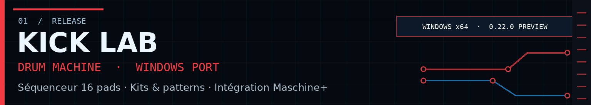
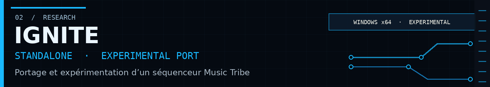
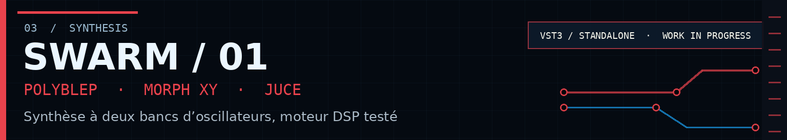

 

**SOUND DESIGN · AUDIO SOFTWARE · DIGITAL SYNTHESIS · MIDI SYSTEMS**

---

### `// 001` — ANKS LABS

**ANKS Labs** est un laboratoire indépendant consacré à la conception et à l’expérimentation d’outils pour la production musicale électronique : instruments virtuels, moteurs audio, applications Windows, séquenceurs et systèmes de contrôle MIDI.

Le laboratoire explore autant le développement de nouveaux instruments que l’adaptation de projets open source existants. L’objectif est de **tester, comprendre, transformer et partager** des outils utiles à la création sonore, sans démarche commerciale systématique.

> **Build. Break. Rewire. Listen.**
>
> Des projets concrets, des prototypes expérimentaux, des tests de moteurs DSP et une approche ouverte de la recherche sonore.

### `// 002` — PUBLIC PROJECTS

**[KICK Lab](https://github.com/olivershadd-star/Berhinger-Kick)** — adaptation indépendante du code KICK publié par Music Tribe. Groovebox Windows portable : 16 pads, patterns, mixage, export audio et contrôle MIDI, notamment avec Maschine+. Une version de démonstration est disponible.

[**Télécharger KICK Lab 0.22.0 preview (Windows x64)**](https://github.com/olivershadd-star/Berhinger-Kick/releases/tag/v0.22.0-preview) · [Sources & documentation](https://github.com/olivershadd-star/Berhinger-Kick)

**[IGNITE — Windows Port](https://github.com/olivershadd-star/Behringer-IGNITE-winport)** — recherche autour du code open source de Music Tribe et reconstruction progressive d’une application autonome pour Windows. Le portage est expérimental et ne constitue pas une version officielle du produit.

[Code, tests et documentation](https://github.com/olivershadd-star/Behringer-IGNITE-winport)

**[SWARM / 01](https://github.com/olivershadd-star/SWARM)** — synthétiseur expérimental original à deux bancs d’oscillateurs PolyBLEP, filtre résonant et morphing XY. **Moteur DSP testé** ; compilation et validation Windows VST3 / standalone encore à confirmer. La présence publique du code ne signifie pas que le projet est sous licence open source.

[Architecture et statut technique](https://github.com/olivershadd-star/SWARM)

### `// 003` — EXPERIMENTAL DEVELOPMENT

Les autres expérimentations publiques comprennent **[CURVE-PILOT](https://github.com/olivershadd-star/CURVE-PILOT)**, **[CURVE-EDITOR-M4L](https://github.com/olivershadd-star/CURVE-EDITOR-M4L)** et **[MOOGER](https://github.com/olivershadd-star/MOOGER)**. Certaines de ces pages sont encore en phase de préparation et ne constituent pas des versions distribuables.

Domaines explorés :

- **Synthèse & DSP** — oscillateurs, filtres, modulations, moteurs audio et traitement du signal.
- **Windows & plugins** — applications autonomes, intégration VST3 et interfaces expérimentales.
- **MIDI & hardware** — contrôle de machines, mapping, séquenceurs et passerelles logicielles.
- **Open source research** — étude, adaptation et évolution de code publié par des communautés ou fabricants.

### `// 004` — OPEN DEVELOPMENT / LICENCES

Les portages **KICK Lab** et **IGNITE** sont des projets communautaires indépendants, fondés sur des sources ouvertes de Music Tribe et soumis aux licences indiquées dans leurs dépôts respectifs. Les marques **Behringer, Music Tribe, Native Instruments et Maschine** appartiennent à leurs titulaires. Aucun de ces portages n’est un produit officiel de ces fabricants.

**Tous les dépôts publics ne sont pas automatiquement open source.** Le droit de réutiliser ou redistribuer du code dépend de la licence propre à chaque projet. Les autres outils ANKS Labs peuvent être des expérimentations publiques, des projets privés ou des logiciels distribués sans publication du code source.

### `// 005` — CONTACT & COLLABORATION

ANKS Labs est ouvert à l’échange technique autour de l’audio numérique, de la synthèse, du MIDI et de l’expérimentation logicielle. Pour discuter d’un projet public, utiliser ses **Issues** ou **Discussions** lorsque ces espaces sont activés.

---

**ANKS LABS**

`AUDIO DEVELOPMENT  //  EXPERIMENTAL SOFTWARE  //  ELECTRONIC INSTRUMENTS`

[**Explore all public repositories**](https://github.com/olivershadd-star?tab=repositories)

